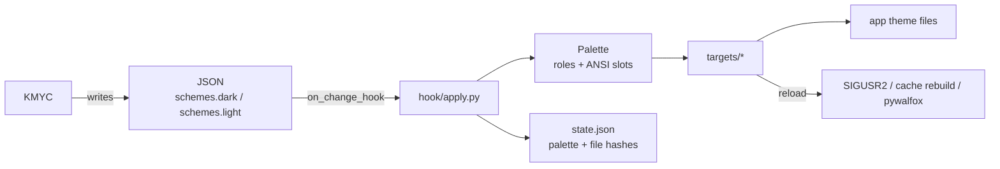

# dotfiles-kde-colors

KDE Material You palette → app themes. This is an `on_change_hook` for
[kde-material-you-colors](https://github.com/LuisBocanegra/kde-material-you-colors)
(KMYC): every time KMYC writes a new Material 3 palette, the hook projects it
onto 15 application surfaces — terminals, editors, GTK, Discord, Steam, YouTube
Music and more — as real theme files, not environment variables.

Palette source is KMYC's JSON (`/tmp/kde-material-you-colors-$USER.json`,
covering both `schemes.dark` and `schemes.light`); the hook is a consumer only,
KMYC stays the source of truth.



## Contents

| Path | Role |
|---|---|
| `hook/apply.py` | entry point: CLI, lock, state, target loop |
| `hook/mycolors.py` | OKLab/OKLCH maths, WCAG contrast, M3 `Palette`, ANSI mapping |
| `hook/template.py` | renderer for Noctalia's `{{ colors.* }}` template syntax |
| `hook/managed.py` | atomic writes, one-shot backups, managed key lines, log rotation |
| `hook/localstorage.py` | minimal Chromium LevelDB reader/writer (Hayase target) |
| `hook/context.py` | per-run context passed to targets |
| `hook/targets/` | one module per app; registered in `hook/targets/__init__.py` |
| `hook/templates/` | theme templates (Discord ×3, Pear Desktop, Hayase) |
| `hook/archive/` | retired targets, kept for reference — never loaded |
| `config.example.conf` | the KMYC settings this hook needs |

## Requirements

- Linux + [kde-material-you-colors](https://github.com/LuisBocanegra/kde-material-you-colors) generating a palette
- Python ≥ 3.9, standard library only — no pip packages
- Optional: only the apps you actually run; each target skips itself when its
  config directory is absent

## Install

```bash
git clone https://github.com/ItzMeDwii/dotfiles-kde-colors.git \
  ~/.config/dotfiles-kde-colors
```

Then wire the hook in `~/.config/kde-material-you-colors/config.conf`
(see `config.example.conf`) — `on_change_hook` may point anywhere:

```ini
[CUSTOM]
on_change_hook=$HOME/.config/dotfiles-kde-colors/hook/apply.py
pywal=true
```

`pywal=true` is required by the `firefox` target: pywalfox reads
`~/.cache/wal/colors.json`, which KMYC exports. Apply once:

```bash
python3 ~/.config/dotfiles-kde-colors/hook/apply.py --verbose
```

Keep the repository layout intact: `targets/` and `templates/` are resolved
relative to `apply.py`, and `state.json` / `.lock` / `backups/` are created next
to it. Cloning the repo *as* `~/.config/kde-material-you-colors` also works, as
long as `config.conf` stays untracked.

## Usage

```
apply.py [--json PATH] [--dry-run] [--force] [-v] [--only NAME]... [--list]
```

| Flag | Effect |
|---|---|
| `--json PATH` | KMYC JSON to read (overrides `KMYC_JSON`, then `/tmp/kde-material-you-colors-$USER.json`) |
| `--dry-run` | log every intended write, change nothing, skip reloads |
| `--force` | ignore the palette-hash/up-to-date short circuit |
| `-v`, `--verbose` | log to stderr too (also automatic when stderr is a TTY) |
| `--only NAME` | run one target; repeatable; does not save `state.json` |
| `--list` | print target names |

Exit codes: `0` success, `1` failure (unreadable JSON or any target raised),
`2` unknown `--only` name. A failing target is logged with its traceback and
does not stop the rest of the run.

## Targets

| `--only` | Writes | Also touches |
|---|---|---|
| `alacritty` | `~/.config/alacritty/material-you.toml` | `alacritty.toml`: `[general] import`, `[window] decorations_theme_variant`; existing user `[colors]` tables are migrated into the generated file on first run (Alacritty loads imports last) |
| `bat` | `~/.config/bat/themes/material-you.tmTheme` | `bat/config`: `--theme="material-you"`; `bat cache --build` when the theme changed |
| `btop` | `~/.config/btop/themes/material-you.theme` | `btop.conf`: `color_theme="material-you"`; running instances get `SIGUSR2` |
| `discord` | `noctalia-material.theme.css`, `noctalia.theme.css`, `discord-system24.css` in Vencord / Vesktop / Webcord / Legcord / Equibop theme dirs | removes the obsolete `material-you.theme.css`; enable one theme in the client |
| `eza` | `~/.config/eza/theme.yml` | — |
| `fastfetch` | `~/.config/fastfetch/config.jsonc` | colour keys only; other settings (modules, format) preserved; a new file seeds fastfetch's default module set |
| `firefox` | `~/.cache/wal/colors.json` | pywalfox daemon socket poke; without a running daemon the palette applies on the next Firefox start |
| `fish` | `~/.config/fish/conf.d/material-you.fish` | colour variables, fzf and `LS_COLORS`; applies to new shells |
| `ghostty` | `~/.config/ghostty/themes/MaterialYou` | `config.ghostty`: `theme = MaterialYou`; live reload via `SIGUSR2` |
| `gtk` | `~/.config/gtk-{3,4}.0/material-you.css` | managed `@import` line in `gtk.css`; `gsettings` `accent-color` (nearest libadwaita accent) and `color-scheme` |
| `hayase` | `~/.config/hayase/material-you-custom-theme.json` + the `settings` record in `~/.config/hayase/Local Storage/leveldb` | LevelDB directory copied to `hook/backups/` once, before the first patch |
| `nvim` | `~/.config/nvim/colors/material-you.lua`, `~/.config/nvim/lua/plugins/material-you.lua` | LazyVim spec that selects the colourscheme |
| `pear-desktop` | `~/.config/YouTube Music/material-you.css` | registers the file in `config.json` → `options.themes`; restart the app |
| `steam-material-theme` | `<steam>/millennium/themes/Material-Theme/css/main/colors/matugen.css` | Millennium `Color` must be `Matugen`; the theme re-reads the file every 1.5 s, so Steam repaints without a restart |
| `vim` | `~/.vim/colors/material-you.vim`, `~/.vim/plugin/material-you.vim` | plugin applies the colourscheme on startup; cterm fallbacks included |

`<steam>` is resolved across `~/.local/share/Steam`, `~/.steam/steam`,
`~/.steam/root` and the Flatpak path.

## Palette model

- Variant comes from KMYC's `light` flag; `schemes.dark` / `schemes.light` are
  read from the same JSON.
- ANSI slots follow Noctalia's `fixed_palette.cpp` mapping, so terminals agree
  with other Noctalia-aware tools:

| Slot | M3 role | | Slot | M3 role |
|---|---|---|---|---|
| black | surfaceVariant | | br_black | outline |
| red | error | | br_red…br_cyan | same as normal |
| green | primary | | white / br_white | onSurface |
| yellow | secondary | | | |
| blue | tertiary | | | |
| magenta | primaryFixedDim | | | |
| cyan | secondaryFixedDim | | | |

- Every foreground is contrast-checked against `background` (WCAG, 4.5:1) and
  nudged in OKLCH until it passes; colours are also generated in OKLCH for
  derived tones.
- Templates use Noctalia's expression subset:
  `{{ colors.<role>.<default|dark|light>.<format> }}` and `{{ mode }}`, with
  formats `hex`, `hex_stripped`, `rgb`, `rgb_csv`, `rgba`, `hsl`, `hsla`, `red`,
  `green`, `blue`, `alpha`, `hue`, `saturation`, `lightness`. Unknown
  expressions are kept as `{{UNKNOWN:…}}` and logged as warnings.

## Runtime files

| Path | Purpose |
|---|---|
| `hook/state.json` | palette digest + sha256 prefix of every generated file; enables the no-op short circuit |
| `hook/.lock` | `flock` guard — a second instance exits quietly |
| `hook/backups/` | first-touch copies of user files the hook edits, and the Hayase LevelDB |
| `~/.local/share/kde-material-you-colors/hook.log` | log, rotated to `hook.log.1` past 256 KiB |

Writes are atomic (`tmp` + `rename`), and unchanged files are not rewritten.
Backups are skipped for files already carrying the
`kde-material-you-colors hook` marker, so the hook never backs up its own output.

## Troubleshooting

- **Nothing happens on palette change** — read `hook.log`. `palette … already
  applied and files unchanged` means KMYC wrote an identical palette; `--force`
  bypasses that check.
- **`KMYC JSON not found`** — KMYC is not running, or the hook runs in a
  namespace with a private `/tmp`; pass `--json` or set `KMYC_JSON`.
- **Steam unchanged** — the Millennium theme must have `Color: Matugen`
  selected; the log warns when it does not.
- **Discord unchanged** — themes are written but not enabled; pick one under
  Vencord → Themes.
- **Hayase resets** — the app rewrites its localStorage on exit; re-run the hook
  (or let the next KMYC change do it). The pre-patch LevelDB stays in
  `hook/backups/`.

## License

MIT — see `LICENSE`. Vendored Discord theme templates and their provenance are
documented in `THIRD-PARTY-NOTICES.md`.
